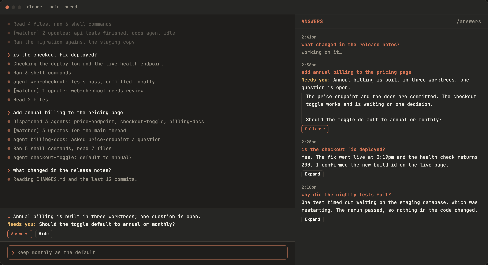

# answers (Claude Code mod)

An answers-only view of a busy main thread: each reply is filed under the prompt it answers.



*Mockup, drawn in Claude colours. The real pane uses your terminal theme.*

- **Band above the prompt:** latest answer's headline + any open "Needs you:" ask. Buttons: Answers, Hide.
- **`/answers` pane:** newest first; time, your prompt as a bold header, the reply's opening paragraph; Expand/Collapse for the full reply.
- Only main-loop replies to prompts you typed are filed (subagent hand-backs, watcher digests and pasted notices are skipped).

## Install

```
/plugin marketplace add rjohnt/answers-claude-mod
/plugin install answers@answers-claude-mod
```

Or load it without installing: copy this folder into your session's dev-mods folder (hot reload), or run `claude --plugin-dir <this folder>`.
Check: `claude plugin validate .` and `claude plugin test .`

MIT licensed.
